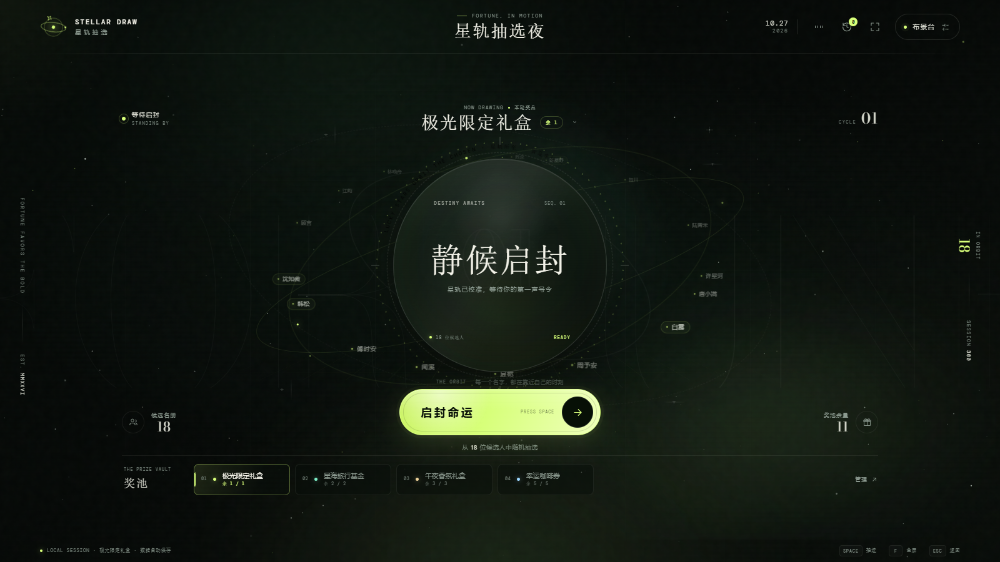

# 星轨抽选 · STELLAR DRAW

一款纯静态、可完全定制的沉浸式抽奖网页。没有后台、没有账号、没有上传：名单、奖池与记录都留在当前浏览器里。



> 若预览图未随项目提供，可直接打开 `index.html` 查看实际效果。

## 亮点

- **星轨舞台**：中央「命运核心」带着候选人名字缓慢环绕，抽选时加速流转，揭晓时绽放粒子与光晕。
- **完全可定制**：批量编辑候选人，增删改奖品与库存，修改活动名称与副标题，四种氛围光色随时切换。
- **现场友好**：空格一键抽选、全屏投影、抽选音效、揭晓礼花，以及可回退的中奖记录。
- **音乐自由**：内置 Web Audio 生成的极光声景，无版权限制；也可以拖入自己的 MP3 / WAV / OGG / M4A。
- **本机持久化**：刷新页面不会丢失进度；配置可导出为 JSON，换设备继续使用。
- **响应式**：桌面、平板与手机都能完成从布置到抽选的完整流程。

## 快速开始

1. 直接双击 `index.html`，用现代浏览器打开。
2. 点右上角「布景台」，在「名单」和「奖池」里布置你的活动。
3. 需要音乐时，到「音律」页选择内置声景，或拖入本地音频。
4. 回到舞台，按空格或点击「启封命运」。建议按 `F` 进入全屏投影。

如果浏览器对本地文件限制较多，可在项目目录启动一个静态服务器：

```bash
python -m http.server 8765
```

然后访问 `http://127.0.0.1:8765/`。

## 操作说明

### 名单

- 每行一个名字，也支持逗号、顿号、分号分隔。
- 重名会自动合并；单个名字最长 32 个字符，最多 1000 位候选人。
- 打开「中奖后移出候选池」后，每位中奖者只会被抽中一次。

### 奖池

- 设置奖品名称、数量与颁奖文案，并从五种光色中挑一个。
- 点击奖池中的奖品卡片，可把它设为下一轮奖品。
- 奖品可以随时编辑或删除；已送出的数量会保留在记录中。
- 某份奖品抽完后会自动跳到下一份可用奖品，所有奖品送完则暂停抽选。

### 音律

- **极光合成器**：页面内实时生成的氛围声景，不需要任何音频文件。
- **我的音乐**：支持拖拽或点击上传，单个文件不超过 80 MB，最多保留 60 首。
- 音量、静音状态与当前曲目会自动记住。
- 浏览器要求先与页面互动一次，音乐才能播放；这是自动播放策略，不是故障。

### 记录与回退

- 每次揭晓都会记录中奖者、奖品与时间。
- 「撤销最近一轮」会把奖品库存和中奖者状态一起还原。
- 「清空记录」只删除历史，不影响当前名单和奖池。

### 数据与设置

- **导出配置**：下载包含名单、奖池、选项与历史的 JSON 文件。
- **导入配置**：从 JSON 恢复活动；导入只恢复配置，不会恢复音频文件本身。
- **恢复演示数据**：清空当前进度，并移除本机上传的音频。
- 所有数据保存在当前浏览器的 `localStorage`；音频文件保存在 `IndexedDB`，不会发送到服务器。

## 键盘快捷键

| 按键 | 作用 |
| --- | --- |
| `Space` | 开始抽选 |
| `F` | 进入 / 退出全屏 |
| `Esc` | 关闭布景台或确认框；揭晓后返回待机 |

在输入框、按钮聚焦时，空格会执行控件本身的行为，不会误触抽选。

## 部署

把整个目录原样上传到任意静态托管即可，例如 GitHub Pages、Netlify、Vercel 或自己的 Nginx：

```text
index.html
css/
js/
assets/
```

- 不需要构建步骤、依赖安装或服务端接口。
- 字体已随项目放在 `assets/fonts`，不依赖外部 CDN。
- 请保持目录结构不变，否则样式、脚本或字体可能无法加载。
- 自定义音频不会进入导出的 JSON，也不会随静态部署一起发布；换设备后需要重新上传。

## 浏览器与使用提示

- 推荐最新版 Chrome、Edge、Safari 或 Firefox。
- 全屏、音频播放都需要一次真实的点击或按键触发；部署在跨域 iframe 中时，全屏可能被浏览器禁止。
- 音频格式支持取决于浏览器。若某首歌无法播放，优先尝试 MP3 或 WAV。
- 手机端奖池横向滚动，卡片边缘的渐隐表示还有更多奖品。
- 页面不会主动阻止系统休眠，长时间投影时建议在系统设置里关闭自动息屏。
- 清除浏览器站点数据会同时清除名单、记录和已上传的音乐，重要活动前请先导出配置。

## 文件结构

```text
.
├─ index.html            # 页面结构、图标与抽屉
├─ css/
│  ├─ base.css           # 变量、字体、氛围与全局动画
│  ├─ stage.css          # 舞台、命运核心与轨道名字
│  ├─ controls.css       # 抽选按钮与奖池卡片
│  ├─ drawer.css         # 布景台外壳与名单面板
│  ├─ panels.css         # 奖池 / 音律 / 记录 / 设置与弹层
│  └─ responsive.css     # 响应式与减少动态效果
├─ js/
│  ├─ core.js            # 默认数据、校验、存储与随机算法
│  ├─ audio.js           # 生成式声景与音频播放
│  ├─ effects.js         # 星空、流星与礼花
│  └─ app.js             # 渲染、抽选流程与交互
└─ assets/
   └─ fonts/             # 自托管字体
```

---

愿每一颗名字，都在自己的时刻发光。
